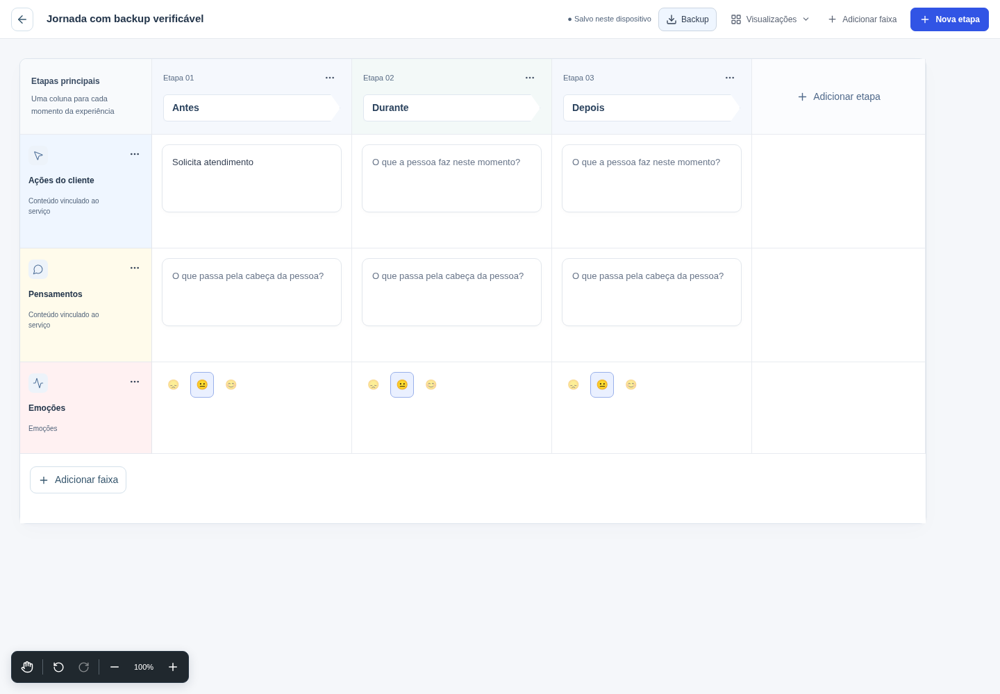

<p align="center">
  
</p>

# Blue Ocean Service Studio

**Da experiência do cliente à operação do serviço, em um só projeto.**

[](https://github.com/CAMBRUSSIJJ/blue-ocean-service-studio/actions/workflows/quality.yml)
[](https://nodejs.org/)

Construa Jornadas, explore ideias no Whiteboard e detalhe a operação no Blueprint
sobre os mesmos dados do serviço. Comece em branco ou use um modelo editável,
sem precisar preencher uma pesquisa antes de desenhar.

[Começar](#começar) · [Documentação](docs/README.md) · [Contribuir](CONTRIBUTING.md) · [Histórico](CHANGELOG.md)



*Editor em execução com uma estrutura inicial e dados fictícios de demonstração.*

## O que você pode fazer

| Área | Para que serve |
| --- | --- |
| **Jornadas** | Mapear etapas, ações, pensamentos, emoções e pontos de contato, com faixas configuráveis e cartões editáveis. |
| **Whiteboard** | Explorar livremente, organizar ideias e trabalhar com objetos vinculados ao serviço. |
| **Blueprint** | Relacionar a experiência à operação: evidências do serviço, linha de frente, bastidores e processos de suporte. |
| **Revisão da entrega** | Identificar lacunas, vínculos ausentes, dependências circulares, prazos inviáveis e desequilíbrios entre capacidade e demanda. |
| **Continuidade** | Navegar entre Jornada e Blueprint preservando a identidade dos dados e exportar backups do trabalho. |

## Começar

Requisitos: **Node.js 22** e **npm 10 ou superior**. O ambiente de nuvem validado
usa npm 10.9.2; o arquivo `.nvmrc` seleciona a linha 22 do Node.

```bash
git clone https://github.com/CAMBRUSSIJJ/blue-ocean-service-studio.git
cd blue-ocean-service-studio
npm ci
npm run dev
```

Abra o endereço informado pelo Vite no terminal. Na tela de entrada, escolha
**Abrir workspace local sem conta**, crie um projeto e comece uma Jornada ou
um Whiteboard. Os modelos criam estruturas editáveis; não inventam pesquisas
ou observações sobre seus clientes.

**Seus dados ficam no navegador.** O fluxo local não exige backend, banco de
dados ou credenciais externas. Exporte um backup para preservar outra cópia
e antes de limpar os dados do navegador ou trocar de dispositivo. A entrada
local não equivale a autenticação de um serviço remoto.

Perfis locais compartilham os projetos deste navegador. Login social e acesso
entre dispositivos ainda não estão disponíveis. Os pré-requisitos para uma
oferta de equipe estão descritos em [colaboração remota](docs/colaboracao-remota.md).

Para outros ambientes, consulte o [guia de desenvolvimento](docs/desenvolvimento.md),
as [instruções para Linux](README-LINUX.md) ou a
[configuração da nuvem](.cloud-environment/README.md).

## Validar e gerar a distribuição

```bash
npm run release:verify
```

Esse comando verifica ambiente, lockfile, TypeScript, contratos de regressão,
build de produção e integridade da distribuição em `dist/`.

| Comando | Uso |
| --- | --- |
| `npm run dev` | Desenvolvimento com atualização automática. |
| `npm run typecheck` | Verificação de tipos. |
| `npm run qa` | Suítes de regressão estáticas, contratuais e de domínio. |
| `npm run docs:check` | Verificação dos links locais da documentação atual. |
| `npm run build` | Build de produção e verificação do `dist`. |
| `npm run preview` | Inspeção local do build já gerado. |
| `npm run entry:browser` | Fluxo de entrada e criação de Jornada em Chromium. |
| `npm run product:browser` | Navegação entre áreas, backup e acessibilidade em desktop e celular. |

Os testes de navegador requerem Python, Playwright e Chromium. Consulte os
[níveis de teste e seus pré-requisitos](docs/testes.md). Conclua build e QA
antes de iniciar o Vite; se esses comandos regenerarem os assets com o servidor
ativo, reinicie-o para atualizar o cache de arquivos públicos.

## Organização do repositório

```text
.cloud-environment/   Instalação e inicialização do ambiente de nuvem
.github/             Integração contínua e modelos de colaboração
docs/                Guias atuais e índice de documentação
  archive/           Notas, auditorias e relatórios históricos preservados
public/              Assets estáticos e arquivos gerados pelo preparo
qa/                  Contratos de UX e simulador de Whiteboard
scripts/             Preparo de assets, verificações e testes
src/                 Código-fonte da aplicação
```

O código-fonte canônico está em `src/`. Assets `public/v*.js`, `public/v*.css`,
o módulo de versão e `dist/` são gerados. Consulte a
[política de código-fonte e artefatos](SOURCE_AUTHORITY.md).

## Documentação e colaboração

- [Índice da documentação](docs/README.md): guias por objetivo.
- [Arquitetura](docs/arquitetura.md): dados, persistência e integração dos editores.
- [Publicação](docs/deployment.md): build e configuração da Vercel.
- [Contribuição](CONTRIBUTING.md): fluxo de trabalho e critérios de entrega.
- [Segurança](SECURITY.md): como comunicar um problema com responsabilidade.
- [Código de conduta](CODE_OF_CONDUCT.md): convivência no projeto.
- [Arquivo histórico](docs/archive/README.md): evolução do produto e evidências por versão.

## Licenciamento

Este repositório ainda não declara uma licença de uso ou redistribuição.
Consulte o responsável pelo projeto antes de reutilizar seu código em outro produto.
