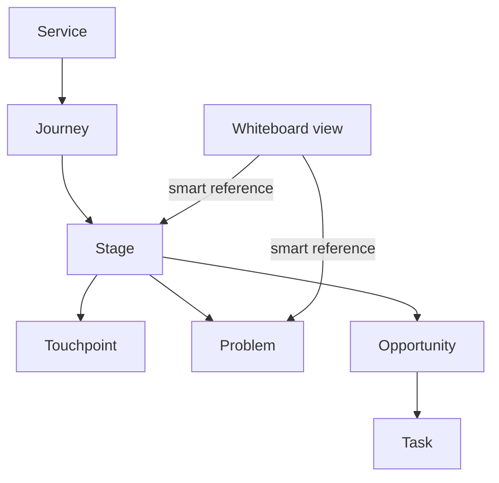

# Arquitetura V1.4 — Service Graph 2.0

## Fonte de verdade

`ServiceGraph` é o documento versionado. A versão 2 contém o serviço, jornadas, etapas, touchpoints, problemas, oportunidades, tarefas, o rascunho do Blueprint e as configurações das views. A Journey e o Plano de Ação usam os mesmos IDs. A linha Ações do Cliente no Blueprint lê as etapas da Journey.

Um item livre no Whiteboard armazena texto e geometria. Um item inteligente armazena `objectKind` e `objectId`; não copia o objeto. A V1.4 prepara esse contrato e a validação, sem expor um Whiteboard prematuro na sidebar.

## Pastas

| Pasta | Responsabilidade |
|---|---|
| `domain/` | Tipos, schemas, migração e operações puras do grafo |
| `repositories/` | Persistência e importação/exportação locais |
| `state/` | Controller React e histórico de alterações |
| `views/` | Journey, Blueprint e Plano de Ação |
| `components/` | UI compartilhada |
| `services/` | Contrato de referências inteligentes do Whiteboard |

## Persistência e migração

Na abertura, o repositório tenta primeiro `realtalent-service-studio-v2-service-graph`. Se ausente ou inválido, tenta a chave da V1.3, `realtalent-service-studio-v1-service-graph`. O projeto legado recebe `schemaVersion: 2` e `views.whiteboards: {}`, passa pela validação e é salvo automaticamente na nova chave. A chave legada não é apagada.

Cada importação aceita o JSON legado ou o schema 2. IDs e referências cruzadas são validados antes de substituir o projeto aberto. Versões futuras desconhecidas são recusadas. O salvamento e a exportação também validam o grafo, para que vínculos quebrados não sejam gravados silenciosamente.

## Próximas extensões

A V1.5 pode adicionar objetos de ação do cliente, canais e emoções estruturadas por migração 2 → 3, mantendo os mesmos IDs de Service, Journey e Stage. Quando o editor Whiteboard chegar, ele poderá criar itens livres e associar itens inteligentes a objetos existentes. Conversões de itens livres para objetos do grafo terão de ser ações explícitas, reversíveis e validadas.

## V1.4.2 — Blueprint Whiteboard

O Blueprint passa a ter duas representações do mesmo serviço: uma visão livre de Whiteboard e a visão estruturada clássica. O layout do quadro é uma view; objetos inteligentes apontam para entidades do Service Graph em vez de duplicá-las. A modelagem de Whiteboard agora prevê itens livres, itens inteligentes, conexões e metadados visuais.

## V1.4.3 — Whiteboard UX + Smart Layout

A V1.4.3 adiciona uma camada de preferências visuais separada do documento de negócio. `ServiceGraph.views.whiteboards` continua armazenando quadros, itens e conexões; preferências transitórias/visuais como `layoutMode`, grade, snap e agrupamentos são persistidas em `realtalent-service-studio-v143-whiteboard-meta` no launcher compilado.

Essa separação preserva compatibilidade com o schema 2 e reforça a regra: **o Service Graph é a fonte de verdade; o Whiteboard é uma projeção visual editável**.

Os modos Livre, Blueprint, Fluxo e Journey executam transformações de geometria sobre os mesmos itens. Eles não clonam entidades de domínio. Templates, por outro lado, criam um novo `WhiteboardView`, mantendo o quadro anterior.

## V1.4.4 — Interaction & UI Refinement

A V1.4.4 mantém o schema 2 do Service Graph intacto e adiciona somente estado visual compatível. Preferências específicas do editor passam para `realtalent-service-studio-v144-whiteboard-meta`, com fallback de leitura da chave V1.4.3.

Frames continuam sendo itens livres no `WhiteboardView`; a relação de contenção item → frame é armazenada como metadado de view (`frameParents`). Essa escolha evita transformar agrupamentos espaciais em relações de domínio. Guias inteligentes, zoom, painéis e preferências de snap também permanecem fora do Service Graph.

O princípio arquitetural não muda: **entidades de serviço pertencem ao Service Graph; posição, agrupamento e composição pertencem à view**.

## V1.4.7 — Frames & Structure

A V1.4.7 mantém containers como metadados de **view**, não como relações de domínio. `frameParents` agora aceita hierarquia entre containers, enquanto os próprios itens livres recebem propriedades de apresentação: `containerType`, `padding`, `autoResize`, `collapsed` e `expandedHeight`.

Isso permite nested frames, sections e swimlanes sem contaminar o Service Graph com decisões de composição visual. O motor valida ciclos, preserva a subárvore ao mover containers e usa `containerType: swimlane` para as faixas do Blueprint.

A regra continua sendo: **estrutura visual pertence ao Whiteboard; estrutura de serviço pertence ao Service Graph**.
