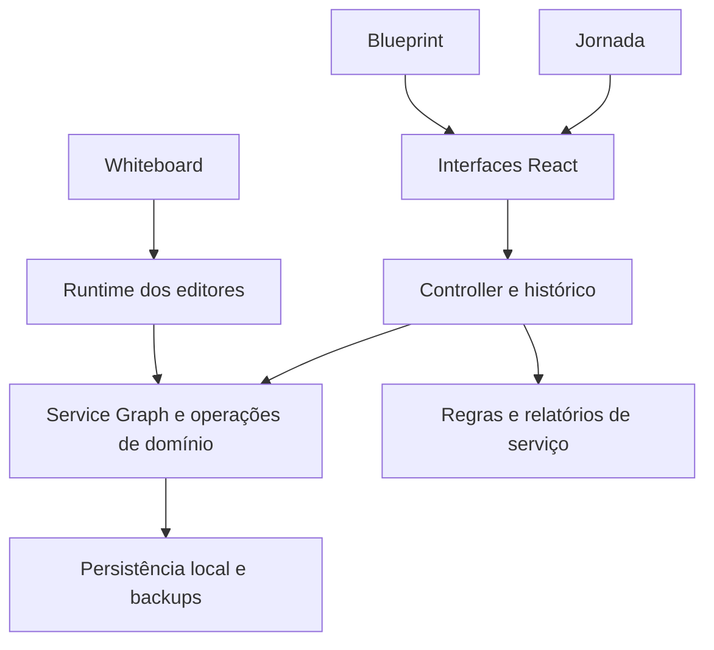

# Arquitetura

O Blue Ocean Service Studio é uma aplicação React/TypeScript construída com Vite.
Jornada, Blueprint e Whiteboard trabalham sobre o mesmo **Service Graph**: um
documento canônico que relaciona o serviço, suas jornadas, etapas e entidades.

## Dados canônicos e apresentação

Os tipos e schemas ficam em `src/domain/`. Operações de domínio e serviços
atualizam o documento e calculam relatórios. O controller em `src/state/` conecta
essas operações às views e ao histórico de edição.

Uma referência visual a uma entidade preserva seu ID; mudar de editor não deve
criar outra cópia do mesmo registro. Geometria, faixas, agrupamentos e composição
visual pertencem às configurações de apresentação do documento.

A continuidade Jornada → Blueprint reutiliza as etapas e seus identificadores.
O Whiteboard permite objetos livres e referências a objetos do serviço. Modelos
criam estruturas editáveis e não devem fabricar evidências de pesquisa ou ações
de clientes como se tivessem sido observadas.

## Persistência e compatibilidade

O fluxo atual persiste dados no navegador e permite importação/exportação.
Schemas, migrações e verificações de integridade protegem o documento e suas
referências. Mudanças precisam preservar dados existentes, metadados desconhecidos,
cancelamento e desfazer/refazer quando esses recursos se aplicam.

Contas locais são parte da experiência no navegador; não há backend de
autenticação ou sincronização obrigatório para o fluxo local.

## React e runtime

`src/main.tsx` monta a aplicação. As views React e os módulos em `src/runtime/`
integram os editores e recursos compartilhados. O design system fica em
`src/design-system/` e `src/components/`.

`scripts/prepare-assets.mjs` prepara os módulos e estilos de runtime em `public/`
e propaga a versão declarada em `package.json`. O build combina esses assets
com o bundle React. A distribuição inclui um manifesto com versão e fingerprints
para rastrear sua origem.

## Verificação

Contratos de código e domínio, testes comportamentais e testes reais no navegador
cobrem responsabilidades diferentes. Consulte o [guia de testes](testes.md)
para selecionar os checks da alteração. A
[política de código-fonte](../SOURCE_AUTHORITY.md) define o que deve ser editado
e o que deve ser gerado.

Descrições arquiteturais de versões antigas estão no
[arquivo de documentação legada](archive/documentacao-legada/).
