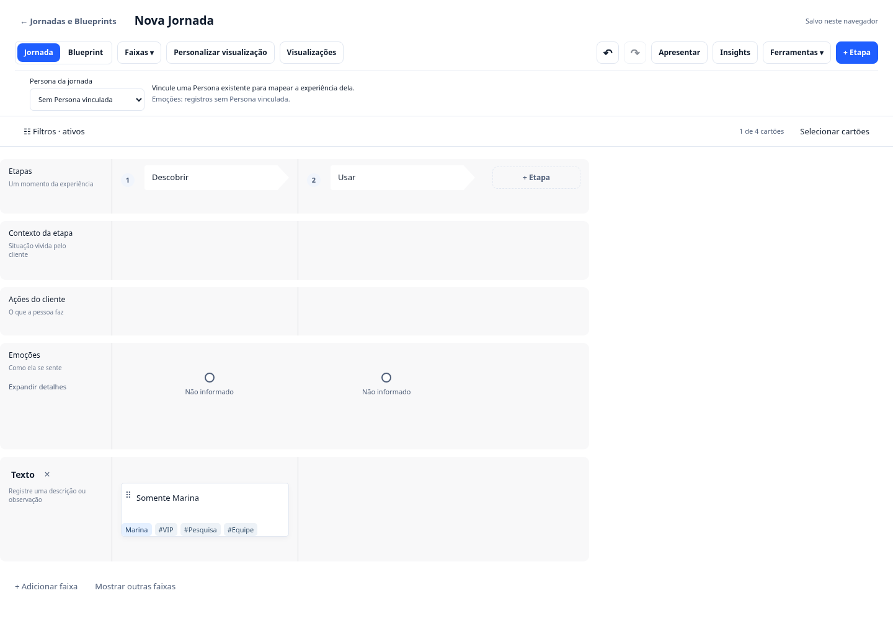
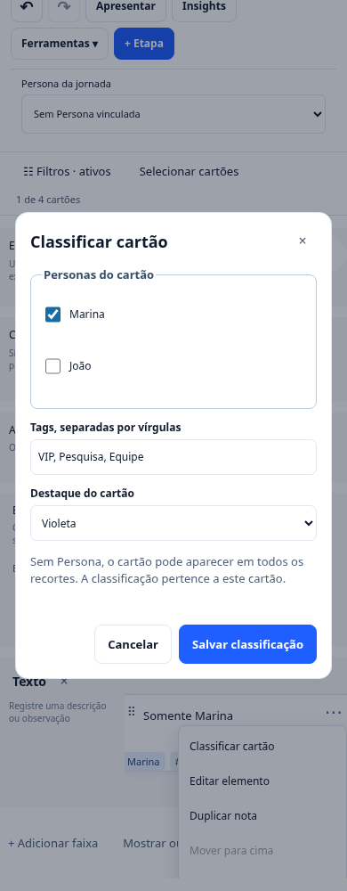

# Personas, tags e edição em lote na Jornada

As jornadas podem mostrar diferentes perspectivas sobre os mesmos cartões.
Classificar ou filtrar um cartão não cria uma cópia da jornada nem duplica
o registro de serviço ao qual ele está vinculado.

## Classificar um cartão

Abra o menu de ações do cartão e escolha **Classificar cartão**. Associe uma
ou mais Personas existentes, informe tags separadas por vírgulas e escolha
uma cor de destaque. **Salvar classificação** confirma a mudança; cancelar
preserva os dados anteriores.

A classificação pertence à representação visual. Duas representações do mesmo
indicador podem ter tags diferentes e continuar apontando para o mesmo indicador.
Duplicar um cartão preserva o vínculo e cria metadados locais independentes.

São até 20 Personas e 20 tags por cartão. Tags têm até 40 caracteres e não
se repetem no mesmo cartão quando diferem apenas por maiúsculas ou espaços.

## Filtrar o conteúdo

Clique em **Filtros** para abrir o painel, que combina busca textual, Persona, tipo de cartão
e tag. A busca também considera o nome atual do registro vinculado e ignora
acentos. Clique em **Aplicar filtros** ou pressione Enter na busca.

**Incluir sem Persona** mantém no recorte os cartões compartilhados, sem
associação específica. Desmarque para mostrar apenas os cartões associados à
Persona escolhida. **Limpar filtros** volta ao conjunto completo das faixas
visíveis.

Etapas, contexto, emoções e o painel nativo de dores permanecem visíveis.
Esses elementos dão contexto ao recorte; o filtro atua nos cartões de conteúdo
das células. A **Persona da jornada**, no cabeçalho, continua definindo o
contexto emocional, independentemente da Persona usada para filtrar cartões.

Filtrar nunca exclui conteúdo. Adicionar, editar, mover ou excluir um cartão
em uma visualização filtrada continua operando sobre sua identidade original.

## Editar vários cartões

1. Clique em **Selecionar cartões**.
2. Marque as caixas dos cartões ou use **Selecionar visíveis**.
3. Em **Classificar seleção**, escolha adicionar/remover tags, adicionar/remover
   Personas ou alterar o destaque de todos os cartões selecionados.
4. Salve a classificação para confirmar uma única operação reversível.

Filtros e faixas ocultas limitam o conjunto selecionável. Uma seleção que ficou
oculta é descartada para evitar alterações em conteúdo que não está sendo visto.
**Concluir seleção** sai do modo de seleção.

**Excluir seleção** pede confirmação. A exclusão remove as representações do
mapa e mantém os registros vinculados do serviço. Desfazer recupera a operação
inteira, incluindo a classificação dos cartões; refazer reaplica a mudança.

## Visualizações, apresentação e backup

As visualizações nomeadas guardam também os filtros atuais. Aplicar uma
visualização usa os dados atuais, sem restaurar uma cópia antiga dos cartões.

Em **Visualizações → Apresentar visualização atual**, os cartões e o HTML
baixado respeitam os filtros. A apresentação executiva completa continua
disponível separadamente. Nenhum desses recortes implementa autorização de
acesso: são formas de visualizar o projeto local.

Personas, tags, destaques e filtros sobrevivem à recarga e ao backup do projeto.
Editar o texto na biblioteca do serviço mantém a classificação local e atualiza
o texto canônico no mapa.

## Referências e escolhas de produto

As funcionalidades foram inspiradas nos fluxos públicos de
[atribuição de Personas](https://helpdesk.smaply.app/personas/how-to-assign-a-persona-to-a-card.md)
e [edição em lote](https://helpdesk.smaply.app/journey-maps/how-to-bulk-edit-cards.md)
do Smaply, consultados em 23/10/2026. A implementação usa código e interface do
Blue Ocean; não incorpora bundles ou assets do Smaply.

Os limites, a busca sem acentos, os filtros combinados e a inclusão opcional
dos cartões sem Persona são decisões do Blue Ocean. A consulta à documentação
não representa teste autenticado nem comprova paridade integral com o Smaply.

## Validação

- `npm run journey:cards:test`: dados legados, filtros, edição atômica,
  referências, serialização e visualizações.
- `npm run journey:cards:browser`: classificação, edição filtrada, seleção
  mista, exclusão, cancelamento, desfazer/refazer, persistência, apresentação,
  exportação e acessibilidade em 1440, 834 e 390 px.

Consulte [Testes](testes.md) para os pré-requisitos. As evidências do navegador
ficam em `artifacts/journey-card-tools/` e não são versionadas.
