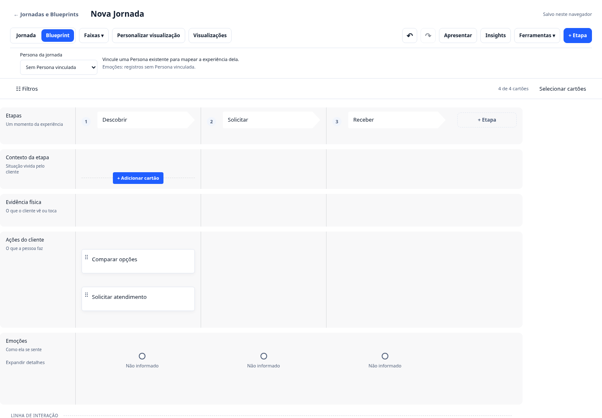

# Uma matriz para Jornada e Blueprint

**Jornadas e Blueprints** é uma única entrada no menu do projeto. A biblioteca
reúne as jornadas e os blueprints existentes, preservando as buscas e a exibição
em cartões ou tabela de cada conjunto. Atalhos e sessões antigos de Blueprint
também abrem essa biblioteca.

## Duas perspectivas no mesmo editor

No cabeçalho do mapa, **Jornada** mostra a experiência do cliente e **Blueprint**
mostra as faixas operacionais. A alternância muda as faixas visíveis e preserva
as faixas personalizadas; não cria etapas, cartões ou cópias do serviço.
**Personalizar visualização**, os demais presets e as visualizações nomeadas
continuam disponíveis. A perspectiva fica salva junto das preferências do mapa.

As linhas têm fundo suave e divisórias entre etapas. Os cartões de texto e
conteúdo usam a mesma borda e superfície, mantendo seus tipos e metadados.
Os títulos das etapas aparecem em formato de seta.

## Adicionar e editar cartões

Passe o ponteiro na célula para mostrar **+ Adicionar cartão** sobre uma linha
tracejada. O mesmo controle aparece antes de cada cartão para inserir naquele
ponto. Use Tab para alcançar os botões pelo teclado. Em dispositivos com toque,
os controles ficam visíveis e têm alvos maiores.

O catálogo mantém texto, cartão, imagem, emoji, link, escala, conteúdo incorporado
e vínculos com registros do serviço. Editar, duplicar, mover, remover e
desfazer/refazer continuam disponíveis. As operações preservam os IDs originais.

## Filtros e ferramentas preservados

**Filtros** abre e recolhe o painel de busca, Persona, tipo e tag. O indicador
avisa quando há filtros ativos, inclusive com o painel recolhido. Classificação,
seleção e edição em lote continuam descritas no [guia dos cartões](journey-card-tools.md).

Nos cartões operacionais vinculados, **Ações da nota → Detalhes operacionais**
abre os detalhes canônicos da atividade ou evidência. A edição operacional
detalhada mantém as restrições existentes em celulares.

**Ferramentas → Recursos avançados** mantém revisão, estratégia e qualidade,
importação/exportação, guia e auditoria dos vínculos. **Editor operacional
completo** dá acesso às demais ferramentas do Blueprint. **Voltar à matriz**
retorna ao editor compartilhado sem duplicar ou remover registros.

## Verificar o fluxo

`npm run maps:matrix:browser` verifica navegação compartilhada, inserção antes
de um cartão, alternância de perspectivas, edição operacional, faixas próprias,
retorno das ferramentas completas, persistência e toque. Também executa Axe
na biblioteca e na matriz em 1440, 834 e 390 px. As evidências ficam em
`artifacts/shared-map-matrix/` e não são versionadas.

## Editor de Mapas 2.0 — navegação e manipulação

A matriz adapta automaticamente a largura inicial das colunas à quantidade de etapas. A barra superior inclui **‹ / ›** para deslocamento horizontal e **− / percentual / +** para zoom (75 a 150%). Com Ctrl ou ⌘ + rolagem sobre o mapa, o zoom também é ajustado. O botão central restaura 100%.

- **Largura da etapa:** passe o mouse na divisória direita do cabeçalho e arraste. Com foco no separador, use **← / →** em incrementos de 20 px (mínimo 210, máximo 600 px).
- **Ordem das faixas:** use a alça ⠿ na lateral esquerda para arrastar a faixa até outra posição. Como alternativa acessível, foque a alça e pressione **Alt + ↑ / ↓**. A personalização existente continua permitindo subir e descer por botões.
- **Altura das faixas:** arraste a pequena divisória inferior da legenda lateral ou use **↑ / ↓** com o separador em foco; os limites são 76 a 540 px. A altura é mínima, de modo que conteúdo longo se expande naturalmente.
- **Recolher/expandir:** use o controle ▴/▾ ao lado da legenda da faixa; os cartões ficam ocultos, **não são excluídos**.
- **Persistência:** zoom, larguras, altura, ordem e recolhimento são preferências opcionais, normalizadas e guardadas com a visualização no Service Graph. Os dados dos cartões, etapas, emoções e demais objetos canônicos não são duplicados.

O mapa continua navegável por rolagem horizontal e teclado. O redimensionamento é independente do movimento de cartões e do arraste dos pontos da curva de emoções.
